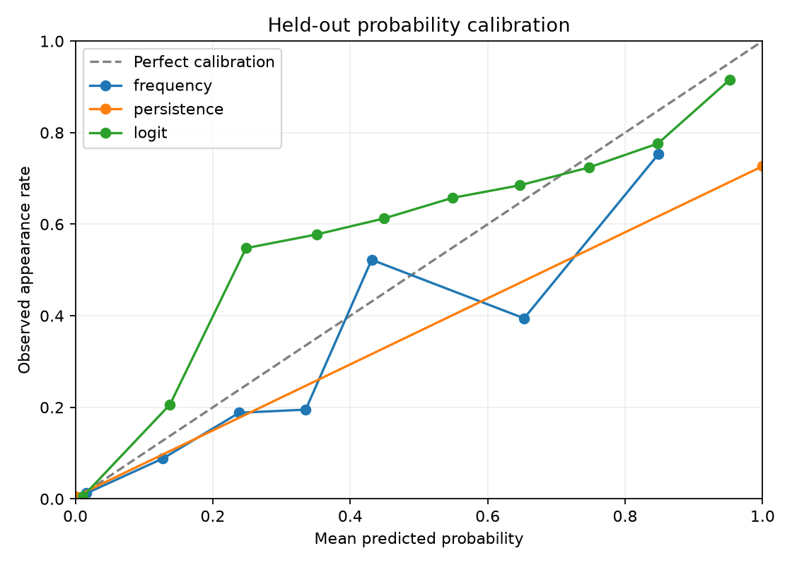

# Final held-out evaluation

Training ends **2026-07-19**. Test: **2026-07-20–2026-10-17**. Model settings, transforms and vocabulary were frozen before the test. Daily features incorporate only earlier observations, including prior days within the test.

Recommendation: **logit**. inconclusive improvement; do not claim statistically established superiority.

| Predictor | Micro AP ↑ | Macro AP ↑ | Brier ↓ | Precision | Recall | k | All-flavour recall@k |
|---|---:|---:|---:|---:|---:|---:|---:|
| frequency | 0.2316 | 0.0847 | 0.01642 | 0.335 | 0.253 | 10 | 0.181 |
| persistence | 0.5322 | 0.4012 | 0.01025 | 0.727 | 0.725 | 10 | 0.445 |
| logit | 0.6386 | 0.4124 | 0.00998 | 0.677 | 0.684 | 10 | 0.450 |

AP is a ranking metric, not classification accuracy. Thresholds and k are inherited from validation. Model retention uses the prespecified micro-AP/Brier gate; menu-recall results must be assessed separately.

## Paired uncertainty

Moving blocks of 7 calendar days; both shops kept together; 200 replicates; percentile 95% intervals; seed 42. Conditional on this fitted model and test period; does not measure training or model-selection uncertainty.

Positive differences favor the selected candidate; Brier differences are baseline error minus candidate error.

| Baseline | AP gain, 95% interval | Brier reduction, 95% interval |
|---|---|---|
| frequency | 0.4070 [0.3501, 0.4515] | 0.00644 [0.00537, 0.00753] |
| persistence | 0.1064 [0.0838, 0.1235] | 0.00027 [-0.00039, 0.00094] |

## Shop results

| Shop | Predictor | Micro AP | Brier | All-flavour recall@k |
|---|---|---:|---:|---:|
| all_saints | frequency | 0.1138 | 0.01554 | 0.120 |
| benet_street | frequency | 0.3116 | 0.01728 | 0.241 |
| all_saints | persistence | 0.6051 | 0.00715 | 0.450 |
| benet_street | persistence | 0.4826 | 0.01328 | 0.440 |
| all_saints | logit | 0.6582 | 0.00819 | 0.452 |
| benet_street | logit | 0.6221 | 0.01172 | 0.449 |

## Coverage

```json
{
  "expected_shop_day_forecasts": 180,
  "scored": 178,
  "invalid_or_missing_target": 1,
  "valid_target_invalid_previous_day": 1,
  "supported_flavours": 461,
  "all_target_appearances": 2410,
  "supported_appearances": 1536,
  "unseen_flavour_appearances": 580,
  "seen_but_below_support_appearances": 294
}
```

Unseen and below-support flavours count as misses in all-flavour menu recall. Per-flavour metrics and training-support groups are saved locally. Macro AP excludes flavours with no test positives; counts are recorded in metrics.json. Missing and quarantined snapshots are not negatives.

## Calibration



## Reproducibility and limitations

Pinned source: `fba48c936c059625f399353e5afa8b071fc51457`. The local model bundle is `artifacts/final/model.joblib`; its training cutoff remains 2026-07-19. Predictions, truth, selection hash, source/config/code/data hashes and checksums are saved under `artifacts/final/`. Rerunning final evaluation returns verified saved results, without retuning or rescoring.

This is an independent final time period, conditional on the development protocol. Format inspection included test-period files during parser development; no model settings were tuned on test scores. Historical collection availability is assumed rather than timestamp-verified. Conservative name matching fragments some flavours. The closed vocabulary cannot identify new flavours. The saved model is local research software, not a guarantee of menu availability.

## Practical interpretation and forecast handover

The paired AP interval supports improved ranking over persistence. The Brier interval includes zero, so improved probability error is inconclusive. At All Saints, Brier error is higher than persistence despite better AP; do not claim uniform improvement across shops. Overall top-10 recall is only 45.0% versus 44.5%. Supported labels account for 63.7% of test appearances, making novelty and sparse labels important limits.

The saved model now powers `.venv/bin/python -m jack_flavours forecast`. It generated 18 October forecasts for both shops from the pinned 17 October issue snapshots. Weights remain fixed at the pre-test training cutoff. Full probabilities and top-10 lists are in artifacts/forecasts, with source/model hashes. The integrity script reproduced every saved held-out prediction from the serialized model. No live refresh or retraining schedule is active.
